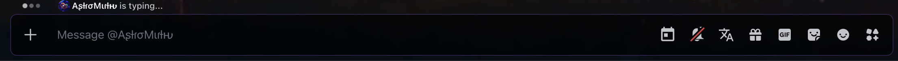
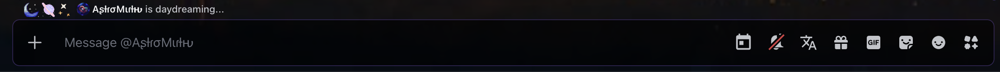

<h1 align="center">TypingIndicators</h1>

<p align="center">
  <a href="LICENSE"></a>
  
  
  <a href="https://github.com/Vendicated/Vencord"></a>
  <a href="https://github.com/Equicord/Equicord"></a>
</p>

Displays other users' custom typing indicators, including emojis, status text and animations, in Discord's native typing bar. Works as a userplugin for [Vencord](https://github.com/Vendicated/Vencord) and [Equicord](https://github.com/Equicord/Equicord).

This repository is a ready-to-install distribution of the plugin, with simple installers and uninstallers for **Windows and macOS**.

Developed and maintained by [TheAstroMirth](https://github.com/TheAstroMirth).

> [!WARNING]
> **Unofficial third-party plugin.** It is not made, reviewed or supported by Discord, Vencord or Equicord. Client modifications are against Discord's Terms of Service. You install and use it at your own discretion and risk.

## Screenshots

### Before



### After



## Features

- **Custom emoji indicators.** Shows the emojis another user chose for their typing indicator, both standard emojis and custom server emojis.
- **Animation support.** Plays the indicator's animation (pulse, ring or wave). Animations are switched off automatically when your system asks for reduced motion.
- **Custom typing status words.** When one person is typing, "typing" is replaced by the word they picked, for example "yapping" or "daydreaming".
- **Native typing-bar integration.** Everything appears inside Discord's own typing bar. No extra panel or popup.
- **Configurable maximum users.** Choose whether indicators are shown when one, two or three people are typing at once.
- **Adjustable typing-bar offset.** Move the typing bar left or right to line it up with your theme.
- **Adjustable text width.** Limit how wide the typing text can get. Longer text ends in `...`.

The plugin only changes what you see. It does not change your own typing indicator or anyone else's.

## Compatibility

| System | Vencord | Equicord |
| --- | --- | --- |
| Windows 10 / 11 | Supported | Supported |
| macOS, Apple Silicon | Supported | Supported |
| macOS, Intel | Supported | Supported |

The plugin is installed the same way for both clients, into `src/userplugins/TypingIndicators/`.

Last built against Vencord `1.15.17` and Equicord `1.15.17.2` (November 2026).

### What you need first

Custom plugins only work when Vencord or Equicord is **built from source**. The normal one-click installer version cannot load them. You need:

1. **An existing source folder of Vencord or Equicord** on your computer (a `git clone`, not a zip).
   - Vencord guide: <https://docs.vencord.dev/installing/> and <https://docs.vencord.dev/installing/custom-plugins/>
   - Equicord guide: <https://github.com/Equicord/Equicord#installing-equicord-devbuild>
2. [Git](https://git-scm.com/downloads), [Node.js LTS](https://nodejs.org/) and [pnpm](https://pnpm.io/installation) (`npm install -g pnpm`).

The installer checks all of this and explains what is missing. It does not set any of it up for you.

## Installation

Download this repository from <https://github.com/TheAstroMirth/TypingIndicators> (**Code > Download ZIP** and unzip it, or `git clone` it). Keep the folders together.

### Windows

1. Open `installers\windows`.
2. Double-click **`install.bat`**.
3. Answer the questions in the window.

### macOS

1. Open `installers/macos`.
2. Double-click **`install.command`**. The first time, macOS may block it: right-click the file, choose **Open**, then **Open** again.
3. Answer the questions in the Terminal window.

### What the installer does

1. Asks whether you use Vencord or Equicord.
2. Checks that Git, Node.js and pnpm are available (and PowerShell on Windows).
3. Asks for your source folder. You can give the folder itself, its `src` folder or its `src/userplugins` folder. It checks that this really is a Git checkout of the client you chose.
4. Looks for an existing `src/userplugins/TypingIndicators`. If there is one that differs, it asks whether to update it, replace it or cancel, and saves a backup first.
5. Copies `index.tsx` and `style.css` and verifies both copies.
6. Runs `pnpm build` and shows its full output. If the client's dependencies are not installed yet, it asks before running `pnpm install --frozen-lockfile`. If the build fails, it explains what that means and offers to roll the plugin folder back to how it was.
7. Asks whether to run the client's own `pnpm inject`.
8. Tells you plainly what was copied, built and injected, and what to do next.

Afterwards, restart Discord and turn the plugin on in **Discord Settings > Vencord** (or **Equicord**) **> Plugins > TypingIndicators**.

### What the installer never does

- It never downloads, clones or installs Vencord or Equicord. If you have no source folder, it explains what is needed and stops.
- It never installs Git, Node.js or pnpm.
- It never replaces your Discord or client installation.
- It never overwrites an existing plugin folder without asking and backing it up first.
- It never edits your client settings file. You enable the plugin yourself in Discord.
- It never asks for administrator rights or uses `sudo`.

`pnpm inject` is part of Vencord / Equicord, not of this project. If you choose to run it, the client fetches its own official installer to patch Discord.

### Options

For scripted or repeated use:

| Windows (`install.ps1` / `uninstall.ps1`) | macOS (`install.sh` / `uninstall.sh`) | Meaning |
| --- | --- | --- |
| `-Client vencord` | `--client vencord` | `vencord` or `equicord`, skips the question |
| `-Source "C:\path"` | `--source "/path"` | Your source folder, skips the question |
| `-Yes` | `--yes` | Do not ask questions, use the default answers. Needs the two options above. Never runs `pnpm inject` and never restores a backup |
| `-NoBuild` | `--no-build` | Do not run `pnpm build` |

## Manual installation

1. Copy the `TypingIndicators` folder from this repository (the one containing `index.tsx` and `style.css`) into your client's source folder, so that you end up with:

   ```text
   src/userplugins/TypingIndicators/index.tsx
   src/userplugins/TypingIndicators/style.css
   ```

   Create `src/userplugins` if it does not exist. Keep the folder and file names exactly as they are.

2. In the source folder, build and inject with the client's normal commands:

   ```sh
   pnpm install --frozen-lockfile   # only if you have not done this before
   pnpm build
   pnpm inject                      # only if Discord is not using this build yet
   ```

3. Restart Discord and enable **TypingIndicators** in **Settings > Vencord / Equicord > Plugins**.

## Settings

Open the plugin's settings from **Settings > Vencord / Equicord > Plugins > TypingIndicators**.

| Setting | What it does | Default |
| --- | --- | --- |
| **Shift** | Left offset of the typing bar, in pixels, while an indicator is shown. Increase or decrease it if the bar does not line up in your theme. | `26` |
| **Max users** | Indicators are shown when up to this many people are typing at the same time (1, 2 or 3). With more people typing, Discord's normal typing bar is shown. | `1` |
| **Max width** | Maximum width of the typing text, in pixels. Longer text is cut off with `...`. | `400` |

## Uninstallation

- **Windows:** double-click `installers\windows\uninstall.bat`
- **macOS:** double-click `installers/macos/uninstall.command`

The uninstaller asks for your client and source folder, shows the exact folder it is going to remove, and asks for confirmation. It removes only `src/userplugins/TypingIndicators`, then offers to rebuild with `pnpm build`. Restart Discord afterwards.

Your other plugins, the `userplugins` folder itself, your settings, and Vencord / Equicord / Discord are left alone.

To remove it by hand, delete `src/userplugins/TypingIndicators` and run `pnpm build`.

### Backups

Whenever the installer replaces or updates an existing plugin folder, it first saves a copy in a new, timestamped folder outside the source folder:

| System | Backup location |
| --- | --- |
| Windows | `%LOCALAPPDATA%\TypingIndicators\backups\` |
| macOS | `~/Library/Application Support/TypingIndicators/backups/` |

```text
backups/
└── 2026-11-10_12-30-00/
    ├── backup-info.txt
    └── TypingIndicators/
        ├── index.tsx
        └── style.css
```

An existing backup is never overwritten, and backups are never deleted automatically. The uninstaller lists your backups and offers to restore one. To restore one by hand, copy its `TypingIndicators` folder back into `src/userplugins/` and run `pnpm build`.

How backups and replacements are kept safe:

- Only backups taken from the **same source folder** are offered. Backups from another folder are counted but not listed.
- Each backup stores a checksum list (`backup-manifest.txt`). A backup is checked before it is restored, and refused if its files have changed, if it has no `index.tsx`, or if it contains links to other places. The restored files are compared with the backup afterwards.
- The folder you are replacing is kept next to the new one until the build result is known, and is never deleted without a checked backup.
- The plugin folder is replaced in one step. If copying fails or the installer is interrupted, the previous folder is put back automatically. If a run is killed before it can clean up, the next run points out the leftover folder and how to recover it.

## Troubleshooting

**The client source folder is not accepted**
The folder must be a Git checkout of the client you selected. It contains `package.json`, `src/plugins` and `scripts/build/build.mjs`. A downloaded zip, the folder of the normal installer version, or Discord's own folder will not work. If you chose Vencord but the folder is Equicord (or the other way round), the installer offers to switch. If you have no source folder yet, follow the guides in [What you need first](#what-you-need-first).

**"Git / Node.js / pnpm was not found"**
Install the missing tool, open a new window and run the installer again. On macOS, Git comes with `xcode-select --install`. pnpm is installed with `npm install -g pnpm`.

**The build failed**
The installer shows the real `pnpm build` output and reports the failure. Common fixes: run `pnpm install --frozen-lockfile` in the source folder, or update the source folder with `git pull` and install again. The plugin files stay in place, so running `pnpm build` again is enough once the cause is fixed. The installer also offers to roll back: your previous plugin folder is put back (or, for a first install, the new folder is removed). It never rolls back without asking.

**`pnpm inject` failed**
Close Discord completely first (on Windows also from the system tray, on macOS with Cmd+Q), then run `pnpm inject` in the source folder again. Injection is handled by Vencord / Equicord; their documentation covers problems with it.

**The client itself does not appear in Discord**
Discord is not loading your build. Run `pnpm inject` in the source folder with Discord closed, then start Discord again. A Discord update can also remove the patch; injecting again restores it.

**TypingIndicators is not in the plugin list**
Discord is loading a different build than the one you just made (for example the normal installer version). Check that `src/userplugins/TypingIndicators/index.tsx` exists, run `pnpm build`, run `pnpm inject` from the same source folder, and restart Discord. Using Vesktop or Equibop? Point it at your build in its settings instead of using `pnpm inject`.

**Typing indicators are not showing**
- Make sure the plugin is turned on and Discord was restarted.
- The other person must have set a custom typing indicator. Without one there is nothing extra to show.
- With the default **Max users** of `1`, indicators are shown only while exactly one other person is typing. Raise it to 2 or 3 if you want them in busier channels.
- Your own typing is never shown to you.
- If the bar looks misplaced, adjust **Shift**.
- Discord changes its code often. If nothing works after a Discord update, open the console (`Ctrl+Shift+I` / `Cmd+Option+I`), look for messages from `TypingIndicators`, and report them.

**An existing installation or backup is in the way**
The installer never overwrites silently. Choose **Update** to replace only `index.tsx` and `style.css`, **Replace** for a clean folder, or **Cancel** to leave everything as it is. Each backup gets its own folder, so earlier backups stay untouched. You can delete old backups yourself at any time. If an installation was interrupted, run the installer again; if it mentions a leftover `.TypingIndicators.old.*` folder in `src/userplugins`, that is the previous copy. The installer offers to put it back when no plugin folder is in place; otherwise delete it once you no longer need it.

**macOS: "cannot be opened because it is from an unidentified developer"**
Right-click the `.command` file and choose **Open**. If it says permission denied, run `chmod +x installers/macos/*.command installers/macos/*.sh` in Terminal.

**Windows: the window closes or scripts are blocked**
Use `install.bat`, not `install.ps1` directly. The `.bat` file starts PowerShell with the right options for this one run only.

## What has been tested

- **Plugin:** the two plugin files are byte-for-byte identical to the original. They were built and type-checked, unmodified, inside current Vencord and Equicord sources, and all three settings are present in both builds.
- **macOS scripts:** syntax check, ShellCheck, and install / update / replace / uninstall / restore runs **on Linux** against mock Vencord and Equicord source folders (paths with spaces, invalid folders, failed copy, failed build with and without rollback, failed inject, interruptions at each stage, damaged and foreign backups, links, other plugins kept).
- **Windows scripts:** written for Windows PowerShell 5.1 with the same safeguards as the macOS scripts. Checked statically (structure, variable and command names, PowerShell 7-only syntax), but **not yet run in PowerShell**.
- Not yet tested on real Windows or macOS hardware, and the plugin's behaviour was not checked inside a running Discord client. Reports are welcome.

## Licence

This project is distributed under the **GNU General Public License v3.0**.
See [LICENSE](LICENSE) for the full licence terms and [NOTICE.md](NOTICE.md)
for the required copyright and licence information.

Issues, suggestions or bug reports:
<https://github.com/TheAstroMirth/TypingIndicators/issues>

## Disclaimer

TypingIndicators is an unofficial, third-party plugin for modified Discord clients. It is not affiliated with, endorsed by or supported by Discord, Vencord or Equicord. Client modifications are against Discord's Terms of Service. You install and use them at your own discretion and risk, and the software is provided without warranty of any kind.
